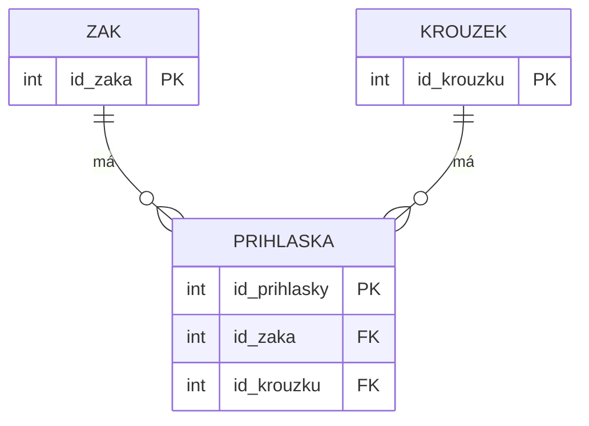

# SP1 Kroužky 
* Kód: 16
# Chyby:
* Jména vedoucích jsou napsaný pokaždý jinak
* Dny jsou někdy napsané celé někdy jen zkratkovitě
* U některých není, zda to je zaplecené

# Klíče
zaci: PK id_zaka
krouzky: PK id_krouzku
prihlasky: PK id_prihlasky, FK id_zaka → zaci, FK id_krouzku → krouzky

# ER DIAGRAM

# SQL
```sql
SELECT nazev, cena_kc
FROM krouzky
WHERE cena_kc > 500;
```
